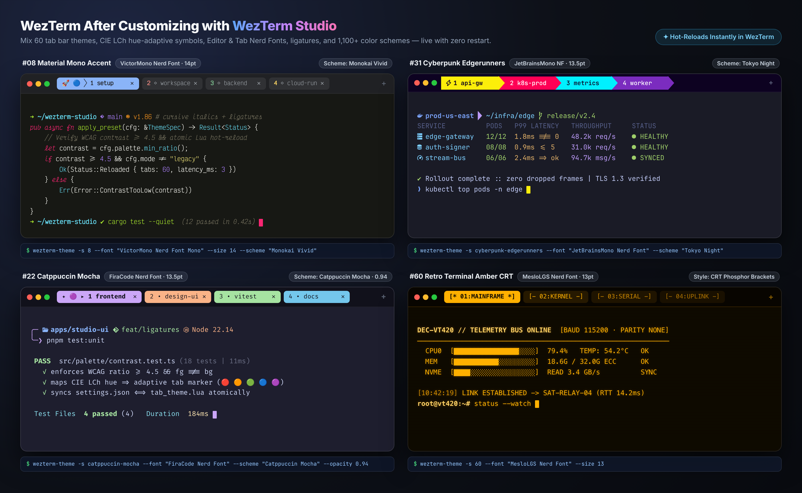
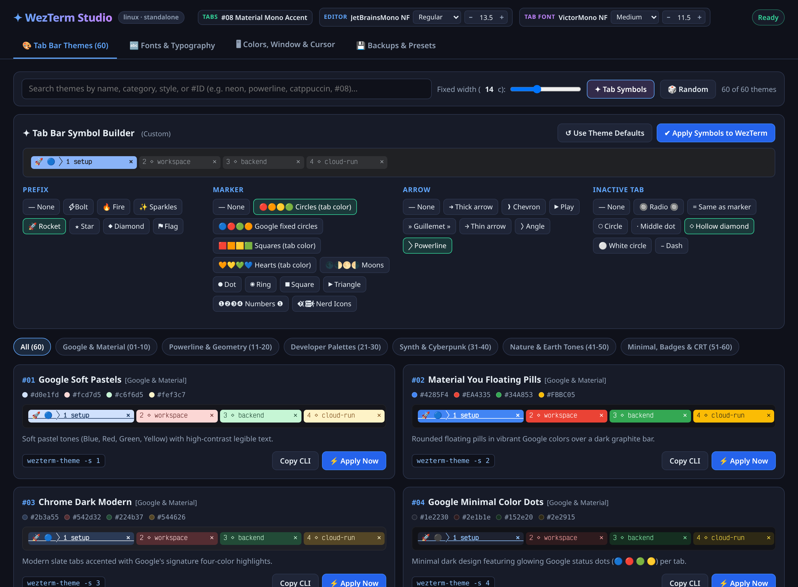
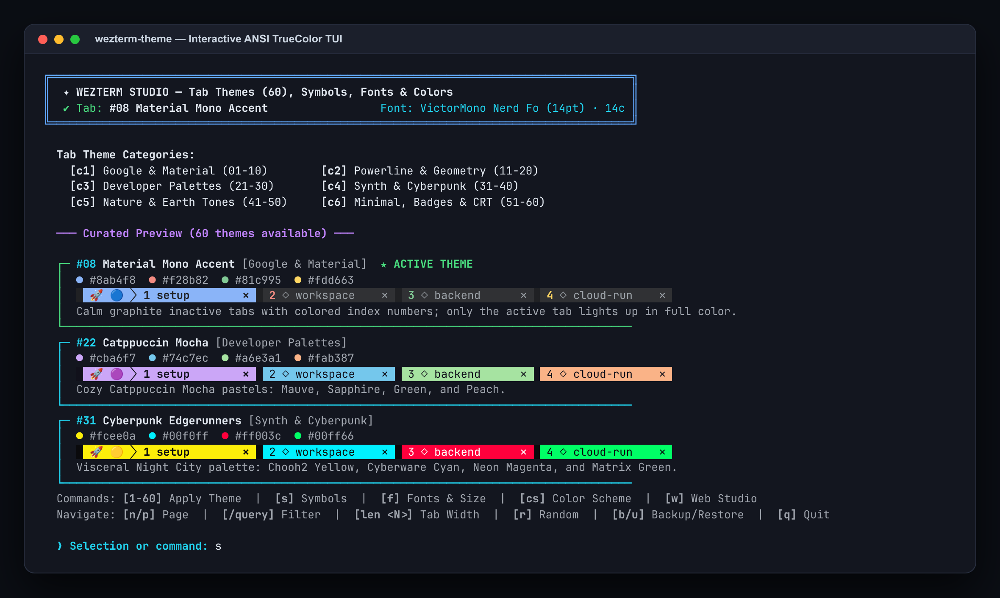

# ✦ WezTerm Studio (`wezterm-theme`)

[](https://github.com/mvsoares/wezterm-studio/actions/workflows/ci.yml)
[](https://pypi.org/project/wezterm-theme/)
[](https://github.com/mvsoares/wezterm-studio/releases)
[](https://www.python.org/)
[](#cross-platform-compatibility)
[](https://github.com/mvsoares/wezterm-studio/blob/main/LICENSE)

**WezTerm Studio** (`wezterm-theme`) is a unified, cross-platform customizer (**Linux, macOS, and Windows**) for **WezTerm** that hot-reloads tab bar themes, custom symbols, monospace/Nerd Fonts, color schemes, and window appearance in real time — with **zero external dependencies** (100% Python `>= 3.10` standard library).



It combines a fast **CLI**, an **ANSI TrueColor TUI**, and a **Local Web Studio** into a single package:

- 🎨 **60 Tab Bar Themes** across 6 curated categories (*Google & Material*, *Powerline & Geometry*, *Developer Palettes*, *Synth & Cyberpunk*, *Nature & Earth Tones*, and *Minimal, Badges & CRT*) with verified WCAG contrast and configurable fixed tab width (`TAB_TITLE_LEN`).
- ✦ **Tab Bar Symbol Builder** — mix active tab prefixes, CIE LCh hue-adaptive markers, Powerline/chevron arrows, and inactive tab indicators.
- 🔤 **Live Font & Nerd Font Picker** — automatically discovers installed monospace and Nerd Fonts via `wezterm ls-fonts`, FontConfig, CoreText, and DirectWrite, with independent family, weight, and size controls for **Editor** and **Tab Bar**.
- 🖥 **1,100+ Built-in Color Schemes & Window Controls** — search and apply WezTerm color schemes, window opacity, inner padding, decorations, cursor style, line height, and scrollback.
- 💾 **Instant Backups & Portable JSON Presets** — automatic pre-validation via `wezterm` with rollback protection, timestamped backups, and OS-agnostic JSON presets shareable across Linux, macOS, and Windows.

---

## ✨ Visual Tour

### 1. Tab Bar Styles & Hue-Adaptive Symbols
Every theme enforces WCAG contrast and uniform character width so tabs never jump as directory names or active processes change. You can keep each theme's native style or layer custom CIE LCh hue-matched symbols on top:


### 2. Browser Web Studio — Tab Themes & Symbol Builder (`wezterm-theme web`)
Interactive live preview of all 60 4-tab bar themes, fixed-width slider, category filters, and 1-click Symbol Builder that hot-reloads WezTerm immediately:



### 3. Browser Web Studio — Live Font & Nerd Font Picker
Renders your actual installed system fonts with programming ligature specimens (`!= === >= =>`), Nerd Font glyph strips, and separate **Apply to Editor** / **Apply to Tabs** actions:


### 4. Interactive ANSI TrueColor Terminal Picker (`wezterm-theme`)
Prefer staying in the terminal or working over SSH? Run `wezterm-theme` with no arguments for the full TrueColor TUI:



---

## 📦 Installation

### From PyPI (`pipx`, `uv`, or `pip`)

```bash
# Recommended: pipx
pipx install wezterm-theme

# Or via uv (persistent tool install)
uv tool install wezterm-theme

# Zero-install instant run with uvx
uvx wezterm-theme

# Or via pip
pip install --user wezterm-theme
```

### Local Clone / Editable Development Install

```bash
git clone https://github.com/mvsoares/wezterm-studio.git
cd wezterm-studio
pipx install -e . --force
# or: pip install --user -e .
```

Both `wezterm-theme` (primary CLI) and `wezterm-tab-theme` (compatibility alias) are installed onto your `PATH`.

---

## 🚀 Quick Start

### 1. Connect to your `wezterm.lua` (one-time setup)

Works out of the box with standard WezTerm configurations on Linux, macOS, and Windows (`~/.config/wezterm/wezterm.lua`, `~/.wezterm.lua`, or `$WEZTERM_CONFIG_FILE`), whether your config uses `wezterm.config_builder()` or returns a plain Lua table:

```bash
wezterm-theme init
```

> **Dual-Mode Support:**
> - **Standalone Mode (default):** Injects a clean, idempotent `dofile(...)` hook into `wezterm.lua` and manages `wezterm_theme.lua` + `wezterm_theme.json` with atomic writes.
> - **JSON Loader Mode:** If your config directory already uses a modular `defaults.json` + `settings.json` loader, `wezterm-theme` detects it automatically and synchronizes `settings.json` and `tab_theme.lua` while preserving all your custom keybindings and rules.

### 2. Launch the Browser Web Studio (Live Fonts + Tabs + Colors)

```bash
wezterm-theme web
# or: wezterm-theme -w
```

Opens `http://127.0.0.1:7777` with live rendering of your installed fonts, programming ligatures (`!= === >= =>`), Nerd Font glyph previews, all 60 4-tab theme cards, interactive symbol composer, appearance sliders, and 1-click live application to WezTerm.

### 3. Open the Interactive TrueColor Terminal Picker (TUI)

```bash
wezterm-theme
```

Keyboard commands inside the TUI:
- `[1-60]` — Apply a tab bar theme immediately
- `[s]` — Open the interactive Tab Bar Symbol Builder
- `[f]` — Open the interactive Font & Size Picker (Editor + Tab Bar)
- `[cs]` — Open the Terminal Color Scheme Picker
- `[w]` — Launch Web Studio in your default browser
- `[c1]..[c6]` / `[/query]` — Filter by category or search keyword
- `[len 15]` — Set fixed tab title character width (`4`–`60`)
- `[r]` — Apply a random theme
- `[b]` / `[u]` — Create or restore a configuration backup
- `[q]` — Quit

### 4. Direct CLI One-Liners

```bash
# Apply a tab theme by ID or slug + set fixed tab width
wezterm-theme -s 8 -t 15
wezterm-theme -s catppuccin-mocha

# Set Editor and Tab Bar fonts & sizes
wezterm-theme --font "JetBrainsMono Nerd Font" --size 13.5 --tab-font "JetBrainsMono Nerd Font" --tab-size 11.5

# Set WezTerm color scheme, window opacity, and padding
wezterm-theme --scheme "Catppuccin Mocha" --opacity 0.95 --padding 10

# Inspect installed fonts, theme catalog, active status, or diagnostics
wezterm-theme fonts --nerd
wezterm-theme --list
wezterm-theme --current
wezterm-theme doctor

# Export / import portable presets across machines (Linux / macOS / Windows)
wezterm-theme export my-setup.json
wezterm-theme import my-setup.json

# Cleanly remove the hook from wezterm.lua
wezterm-theme uninstall --purge
```

---

## 🌍 Cross-Platform Compatibility

| Platform | Config Discovery | Font Discovery | TrueColor TUI & UTF-8 |
| :--- | :--- | :--- | :--- |
| **Linux / BSD** | `$WEZTERM_CONFIG_FILE`, `$XDG_CONFIG_HOME/wezterm`, `~/.config/wezterm`, `~/.wezterm.lua` | `wezterm ls-fonts` + `fc-list` (native binary or Flatpak `org.wezfurlong.wezterm`) | Native |
| **macOS** | `$WEZTERM_CONFIG_FILE`, `~/.config/wezterm`, `~/.wezterm.lua` | `wezterm ls-fonts` (`/Applications/WezTerm.app` / Homebrew + CoreText) | Native |
| **Windows** | `%WEZTERM_CONFIG_FILE%`, `%USERPROFILE%\.config\wezterm`, `%USERPROFILE%\.wezterm.lua` | `wezterm.exe ls-fonts` (Program Files / Scoop / LocalAppData + DirectWrite) | Automatic UTF-8 + Virtual Terminal ANSI mode |

---

## 🧪 Running Tests

All unit and integration tests isolate WezTerm configuration via `WEZTERM_CONFIG_FILE` in temporary directories so your personal `~/.config/wezterm` is never touched:

```bash
python3 -m unittest discover -s tests -v
```

---

## 📄 License

[MIT License](https://github.com/mvsoares/wezterm-studio/blob/main/LICENSE) © Marcus Vinícius Soares.
