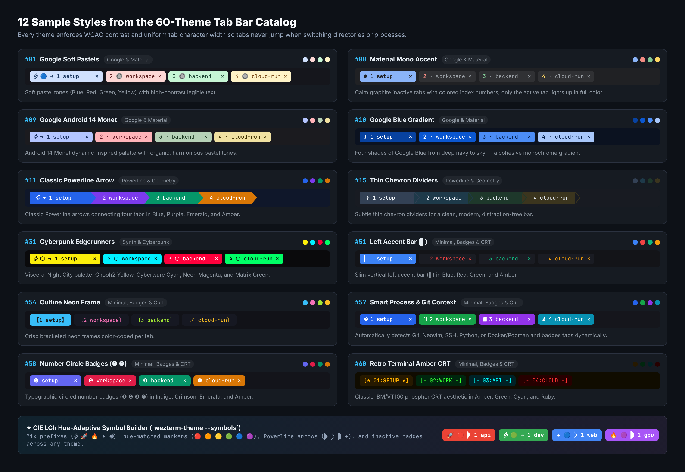
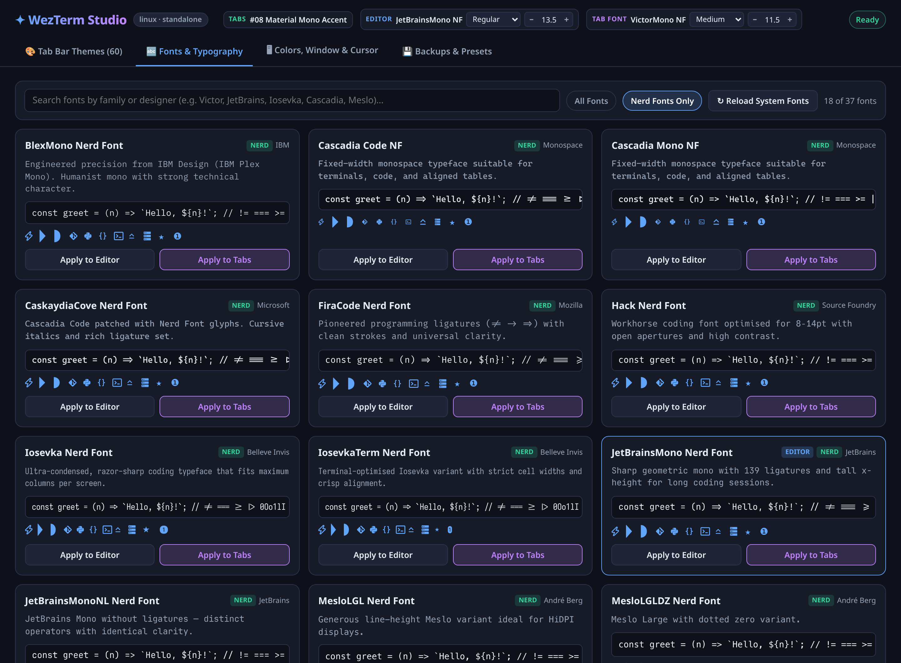

# ✦ WezTerm Studio (`wezterm-theme`)

[](https://github.com/mvsoares/wezterm-studio/actions/workflows/ci.yml)
[](https://pypi.org/project/wezterm-theme/)
[](https://github.com/mvsoares/wezterm-studio/releases)
[](https://www.python.org/)
[](#cross-platform-compatibility)
[](https://github.com/mvsoares/wezterm-studio/blob/main/LICENSE)

**WezTerm Studio** (`wezterm-theme`) is a unified, cross-platform customizer (**Linux, macOS, and Windows**) for **WezTerm** that hot-reloads tab bar themes, custom symbols, monospace/Nerd Fonts, color schemes, and window appearance in real time — with **zero external dependencies** (100% Python `>= 3.10` standard library).


It combines a fast **CLI**, an **ANSI TrueColor TUI**, and a **Local Web Studio** into a single package:

- 🎨 **62 Tab Bar Themes** across 6 curated categories (*Google & Material*, *Powerline & Geometry*, *Developer Palettes*, *Synth & Cyberpunk*, *Nature & Earth Tones*, and *Minimal, Badges & CRT*) — including dynamic **Scheme-Adaptive Powerline** (`#61`) and **Workspace Chameleon** (`#62`), OSC `9;4` progress & split/zoom indicators, mouse hover highlights, verified WCAG contrast, and configurable fixed tab width (`TAB_TITLE_LEN`).
- ✦ **Tab Bar Symbol Builder** — mix active tab prefixes, CIE LCh hue-adaptive markers, Powerline/chevron arrows, and inactive tab indicators.
- 🔤 **Live Font, Ligature, Fallback & Nerd Font Picker** — automatically discovers installed monospace and Nerd Fonts via `wezterm ls-fonts`, FontConfig, CoreText, and DirectWrite, with independent family, weight, and size controls for **Editor** and **Tab Bar**, 1-click HarfBuzz ligatures toggle (`calt`/`clig`/`liga`), and automatic `Symbols Nerd Font Mono` + Emoji fallback chains.
- 🌈 **1,100+ Visual Color Scheme Swatches, OLED Black, Frosted-Glass Blur & Window Controls** — browse visual terminal swatch cards (`bg`, `fg`, `cursor`, 8 ANSI colors, Dark/Light filters), 1-click **OLED `#000000` background** & custom cursor color overrides, cross-platform frosted-glass blur (`macOS`, `KDE`, `Windows 11 Acrylic/Mica`), optional theme-tinted Studio right-status bar, inactive split-pane dimming (`inactive_pane_hsb`), GPU `Oklab` radial gradients, and 1px theme-accented frame borders.
- ⌨ **Native In-WezTerm Command Palette (`Ctrl+Shift+P`), Project Workspace Switcher & Session Snapshots** — switch across all 62 tab themes with inline ANSI swatches, fuzzy-jump across `zoxide` & Git project workspaces, **Save & Restore Workspace Session Snapshots** (`wezterm_session.json`), toggle ephemeral **Presentation / Zen Mode** (`+4pt` font, hidden tab bar, `1.0` opacity, centered padding), step window opacity, toggle ligatures, or launch Browser Web Studio without leaving WezTerm.
- 🚀 **GPU Renderer / FPS Tuner & Quick Select Power Patterns** — configure `WebGpu` / `OpenGL` / `Software`, `max_fps`, `animation_fps`, Linux Wayland mode, and DevOps `quick_select_patterns` (`Ctrl+Shift+Space` for Git SHAs, UUIDs, IPs, K8s pods, and `file:line`), backed by smart CPU/renderer diagnostics in `wezterm-theme doctor`.
- ⚡ **Performance Profiles & Rendering Benchmark** — one-click *Battery saver*, *Max smoothness*, *Remote / no GPU* or *Default* profiles (Web Studio, TUI `[perf]`, `--perf-profile`) that show every setting they change before applying it, plus `webgpu_power_preference`, cursor blink easing and status-bar interval controls. `wezterm-theme doctor --perf` measures what the generated tab-bar and status-bar Lua costs inside WezTerm.
- 🤖 **AI Coding Agent Radar & SSH/Production Danger Tint** — automatically badges tabs running AI coding CLIs (`Claude Code`, `Gemini CLI`, `Antigravity`, `Codex`, `Aider`, `OpenCode`, `Goose`, `Cline`, `Amp`) with `🤖` / `🤖●` + one-shot desktop completion notifications, and tints remote SSH tabs amber (`󰣀`) or production/root SSH sessions (`prod*`, `prd*`, `root@*`) crimson (`⚠ PROD`) so you never confuse production with local.
- 💾 **Instant Backups & Portable JSON Presets** — automatic pre-validation via `wezterm` with rollback protection, timestamped backups, and OS-agnostic JSON presets shareable across Linux, macOS, and Windows.

---

## ✨ Visual Tour

### 1. Tab Bar Styles & Hue-Adaptive Symbols
Every theme enforces WCAG contrast and uniform character width so tabs never jump as directory names or active processes change. You can keep each theme's native style or layer custom CIE LCh hue-matched symbols on top:



### 2. Browser Web Studio — Tab Themes & Symbol Builder (`wezterm-theme web`)
Interactive live preview of all 62 4-tab bar themes, fixed-width slider, category filters, and 1-click Symbol Builder that hot-reloads WezTerm immediately:


### 3. Browser Web Studio — Live Font & Nerd Font Picker
Renders your actual installed system fonts with programming ligature specimens (`!= === >= =>`), Nerd Font glyph strips, and separate **Apply to Editor** / **Apply to Tabs** actions:



### 4. Interactive ANSI TrueColor Terminal Picker (`wezterm-theme`)
Prefer staying in the terminal or working over SSH? Run `wezterm-theme` with no arguments for the full TrueColor TUI:


---

## 📦 Installation

### From PyPI (`pipx`, `uv`, or `pip`)

```bash
# Recommended: pipx
pipx install wezterm-theme

# Or via uv (persistent tool install)
uv tool install wezterm-theme

# Zero-install instant run with uvx
uvx wezterm-theme

# Or via pip
pip install --user wezterm-theme
```

### Local Clone / Editable Development Install

```bash
git clone https://github.com/mvsoares/wezterm-studio.git
cd wezterm-studio
pipx install -e . --force
# or: pip install --user -e .
```

Both `wezterm-theme` (primary CLI) and `wezterm-tab-theme` (compatibility alias) are installed onto your `PATH`.

---

## 🚀 Quick Start

### 1. Connect to your `wezterm.lua` (one-time setup)

Works out of the box with standard WezTerm configurations on Linux, macOS, and Windows (`~/.config/wezterm/wezterm.lua`, `~/.wezterm.lua`, or `$WEZTERM_CONFIG_FILE`), whether your config uses `wezterm.config_builder()` or returns a plain Lua table:

```bash
wezterm-theme init
```

> **Dual-Mode Support:**
> - **Standalone Mode (default):** Injects a clean, idempotent `dofile(...)` hook into `wezterm.lua` and manages `wezterm_theme.lua` + `wezterm_theme.json` with atomic writes.
> - **JSON Loader Mode:** If your config directory already uses a modular `defaults.json` + `settings.json` loader, `wezterm-theme` detects it automatically and synchronizes `settings.json` and `tab_theme.lua` while preserving all your custom keybindings and rules.
>
> If your `wezterm.lua` already registers a `format-tab-title` handler, `init` comments out just that call (it would override the Studio themes) after saving a backup in `backups/`. `wezterm-theme uninstall` re-enables it; pass `--keep-disabled-handlers` to leave it off.

### 2. Launch the Browser Web Studio (Live Fonts + Tabs + Colors)

```bash
wezterm-theme web
# or: wezterm-theme -w
```

Opens `http://127.0.0.1:7777` with live rendering of your installed fonts, programming ligatures (`!= === >= =>`), Nerd Font glyph previews, all 62 4-tab theme cards, interactive symbol composer, appearance sliders, and 1-click live application to WezTerm.

### 3. Open the Interactive TrueColor Terminal Picker (TUI)

```bash
wezterm-theme
```

Keyboard commands inside the TUI:
- `[1-62]` — Apply a tab bar theme immediately
- `[s]` — Open the interactive Tab Bar Symbol Builder
- `[f]` — Open the interactive Font, Size & Ligature Picker (Editor + Tab Bar)
- `[cs]` — Open the Terminal Color Scheme & Window Extras Picker
- `[w]` — Launch Web Studio in your default browser
- `[c1]..[c6]` / `[/query]` — Filter by category or search keyword
- `[len 15]` — Set fixed tab title character width (`4`–`60`)
- `[r]` — Apply a random theme
- `[b]` / `[u]` — Create or restore a configuration backup
- `[q]` — Quit

### 4. Direct CLI One-Liners

```bash
# Apply a tab theme by ID or slug + set fixed tab width
wezterm-theme -s 8 -t 15
wezterm-theme -s scheme-adaptive-powerline
wezterm-theme -s workspace-chameleon

# Set Editor and Tab Bar fonts, sizes & programming ligatures
wezterm-theme --font "JetBrainsMono Nerd Font" --size 13.5 --tab-font "JetBrainsMono Nerd Font" --tab-size 11.5
wezterm-theme --no-ligatures

# Set Dark + Light companion schemes, OLED #000000 override, frosted-glass blur, status bar & Oklab gradient
wezterm-theme --scheme "Catppuccin Mocha" --light-scheme "Catppuccin Latte" --oled --opacity 0.92 --blur 20 --padding 10
wezterm-theme --status-bar --dim-inactive 0.78 --gradient --border --font-fallback

# Tune GPU renderer, refresh rate, Quick Select patterns & inspect saved workspace sessions
wezterm-theme --front-end WebGpu --max-fps 120 --quick-select
wezterm-theme session status

# Performance profiles (default | battery | smooth | remote); explicit flags win over the profile
wezterm-theme --perf-profile battery
wezterm-theme --perf-profile smooth --max-fps 144
wezterm-theme --webgpu-power HighPerformance --cursor-blink-ease Constant --status-interval 10000
wezterm-theme doctor --perf   # renderer, active profile and tab-bar/status-bar Lua cost

# Inspect installed fonts, visual scheme swatches, theme catalog, active status, or diagnostics
wezterm-theme fonts --nerd
wezterm-theme --list-schemes -f "dark catppuccin"
wezterm-theme --list
wezterm-theme --current
wezterm-theme doctor

# Configure status-bar battery indicator (style: nerd|emoji|bar|icon_only|percent; mode: always|hide_full|low_only|off; ETA & critical toast)
wezterm-theme --status-bar --battery-style nerd --battery-mode always --battery-time always --battery-toast

# Configure AI coding agent radar, SSH/prod danger tint, or Ctrl+Shift+P Command Palette actions
wezterm-theme --agent-radar --ssh-alert --command-palette

# Export / import portable presets across machines (Linux / macOS / Windows)
wezterm-theme export my-setup.json
wezterm-theme import my-setup.json

# Cleanly remove the hook from wezterm.lua (and re-enable handlers that init disabled)
wezterm-theme uninstall --purge
```

---

## 🌍 Cross-Platform Compatibility

| Platform | Config Discovery | Font Discovery | TrueColor TUI & UTF-8 |
| :--- | :--- | :--- | :--- |
| **Linux / BSD** | `$WEZTERM_CONFIG_FILE`, `$XDG_CONFIG_HOME/wezterm`, `~/.config/wezterm`, `~/.wezterm.lua` | `wezterm ls-fonts` + `fc-list` (native binary or Flatpak `org.wezfurlong.wezterm`) | Native |
| **macOS** | `$WEZTERM_CONFIG_FILE`, `~/.config/wezterm`, `~/.wezterm.lua` | `wezterm ls-fonts` (`/Applications/WezTerm.app` / Homebrew + CoreText) | Native |
| **Windows** | `%WEZTERM_CONFIG_FILE%`, `%USERPROFILE%\.config\wezterm`, `%USERPROFILE%\.wezterm.lua` | `wezterm.exe ls-fonts` (Program Files / Scoop / LocalAppData + DirectWrite) | Automatic UTF-8 + Virtual Terminal ANSI mode |

---

## 🧪 Running Tests

All unit and integration tests isolate WezTerm configuration via `WEZTERM_CONFIG_FILE` in temporary directories so your personal `~/.config/wezterm` is never touched:

```bash
python3 -m unittest discover -s tests -v
```

---

## 🙏 Credits & Community Inspirations

WezTerm Studio incorporates workflow, tab-bar, status-bar, command-palette, and appearance ideas shared across the WezTerm ecosystem:

- **Community Ecosystem, GitHub Discussions & `r/wezterm` (`v1.4.0`):**
  - **[`MLFlexer/smart_workspace_switcher.wezterm`](https://github.com/MLFlexer/smart_workspace_switcher.wezterm), [`mikkasendke/sessionizer.wezterm`](https://github.com/mikkasendke/sessionizer.wezterm) & [`michaelbrusegard/awesome-wezterm`](https://github.com/michaelbrusegard/awesome-wezterm):** zero-dependency fuzzy `zoxide` & Git repository workspace switcher integrated into WezTerm's `Ctrl+Shift+P` Command Palette.
  - **[`MLFlexer/resurrect.wezterm`](https://github.com/MLFlexer/resurrect.wezterm) & [`YedPool/Wezurrect`](https://github.com/YedPool/Wezurrect):** lightweight cross-platform workspace, tab, and directory snapshot persistence (`Save` / `Restore` in `Ctrl+Shift+P` and `wezterm-theme session`).
  - **[`@jaik3n`](https://github.com/jaik3n) ([WezTerm Discussion #7422 — *"Wezterm Theme Creator"*](https://github.com/wezterm/wezterm/discussions/7422)):** live browser-based OLED `#000000` background and custom WCAG-contrasted cursor color overrides on top of any scheme.
  - **WezTerm Community on [`r/wezterm`](https://www.reddit.com/r/wezterm/), [`r/unixporn`](https://www.reddit.com/r/unixporn/) & [Discussion #628](https://github.com/wezterm/wezterm/discussions/628):** cross-platform frosted-glass blur (`macos_window_background_blur`, `kde_window_background_blur`, `win32_system_backdrop`), automatic `Symbols Nerd Font Mono` fallback chains, DevOps `quick_select_patterns`, and `WebGpu`/`OpenGL`/`Software` + Wayland FPS diagnostics.
- **[WezTerm GitHub Discussion #628 (*"Show your wezterms"*)](https://github.com/wezterm/wezterm/discussions/628) & Ecosystem Plugins (`v1.3.0`):**
  - **[`@sravioli`](https://github.com/sravioli) ([`lantern.wz`](https://github.com/sravioli/lantern.wz)) & [`@itsWindi`](https://github.com/itsWindi):** native in-WezTerm `augment-command-palette` + fuzzy `InputSelector` theme switcher and visual terminal color-scheme swatch explorer.
  - **[`Eric162/wezterm-agent-deck`](https://github.com/Eric162/wezterm-agent-deck) & [`pro-vi/wezterm-attention`](https://github.com/pro-vi/wezterm-attention):** AI coding agent tab status radar (`Claude`, `Gemini`, `Codex`, `Aider`, `OpenCode`, `Goose`, `Cline`, `Amp`) and background completion desktop toast notifications.
  - **[`@williamnoble`](https://github.com/williamnoble) (`#628`) & [`william-ricchiuti/Wezterm-Window-Tint`](https://github.com/william-ricchiuti/Wezterm-Window-Tint):** automatic SSH amber & production/root (`prod*`, `root@*`) crimson tab and status danger tinting.
  - **[`xarvex/presentation.wez`](https://github.com/xarvex/presentation.wez) & [`folke/zen-mode.nvim`](https://github.com/folke/zen-mode.nvim):** ephemeral 1-key Presentation / Zen Mode via per-window `window:set_config_overrides(...)`.
- **[Rashil Gandhi — *"How to Obsessively Tune WezTerm"*](https://rashil2000.me/blogs/tune-wezterm) (`v1.2.0`):** runtime `resolved_palette` + `wezterm.color.gradient` adaptive tabs, OS Dark/Light appearance auto-switching, native OSC `9;4` progress reporting, cross-shell `WEZTERM_CMD` / `WEZTERM_PROG` detection, non-blocking `wezterm.run_child_process` git status, mux domain/latency indicators, and custom `open-uri` workflows.
- **[WezTerm GitHub Discussion #628 (*"Show your wezterms"*)](https://github.com/wezterm/wezterm/discussions/628) (`v1.2.0`):**
  - **[`@wez`](https://github.com/wez) (Wez Furlong):** WezTerm itself, plus `wezterm.GLOBAL` hot-reload-persistent state caching and launcher tips.
  - **[`@gsuuon`](https://github.com/gsuuon):** deterministic workspace-hashed tab/bar accent coloring (*Workspace Chameleon*).
  - **[`@sravioli`](https://github.com/sravioli), [`@cstrahan`](https://github.com/cstrahan) & [`@GrzegorzKozub`](https://github.com/GrzegorzKozub):** instant `⚡ LEADER` & active key-table modal status pills and responsive status-bar width handling.
  - **[`@cstrahan`](https://github.com/cstrahan), [`@UnderCooled`](https://github.com/UnderCooled) & [`@GrzegorzKozub`](https://github.com/GrzegorzKozub):** zoomed-pane (`is_zoomed`) & split-count tab badges, HarfBuzz ligatures toggle, and stack-trace `file:line` `$EDITOR` hyperlinks.
  - **[`@bennypowers`](https://github.com/bennypowers), [`@cstrahan`](https://github.com/cstrahan) & [`@robsonjorgefernandez`](https://github.com/robsonjorgefernandez):** inactive split-pane dimming (`inactive_pane_hsb`), accented split dividers (`colors.split`), and mouse `hover` tab highlights.
  - **[`@mazznoer`](https://github.com/mazznoer), [`@robsonjorgefernandez`](https://github.com/robsonjorgefernandez) & [`@habahabahaba`](https://github.com/habahabahaba):** GPU `Oklab` radial background gradients and 1px theme-accented `window_frame` borders.

---

## 📄 License

[MIT License](https://github.com/mvsoares/wezterm-studio/blob/main/LICENSE) © Marcus Vinícius Soares.
